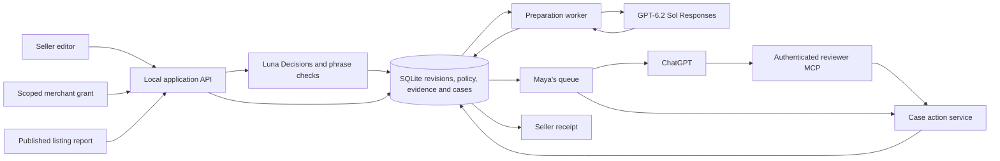

# Seller Listing Validator for the Amazon onsite

The seller resolves a clear photo mismatch during submission. Maya receives the disputed coffee claim, its exact-SKU manufacturer record and a prepared recommendation. She can request a correction, and the seller sees the receipt and revalidates the draft. The pilot scorecard separates cases per 1,000 from active minutes per case.

[Onsite presentation](docs/onsite/amazon-onsite.html) · [18-minute click script and rehearsal notes](docs/onsite/rehearsal.md) · [Saved release results](eval/rehearsal-results.json)

## Onsite workspace

Start the app using the commands below. The root opens **Seller studio**. **Reviewer queue** contains the shopper and merchant intakes. Request help on the graphite headphones to add the third entry. **Pilot impact** contains editable scenario assumptions. **Technical workspaces** provides policy shadow tests, steward source changes, engineering release evidence and read-only audit. **Comparison lab** opens the original manual checker, latency benchmark and inference calculator.

Use Node 26 on the onsite Mac. SQLite stores immutable draft revisions, evidence, policy snapshots, case receipts, worker state and review activity in `tmp/onsite/rehearsal.sqlite`. The two coffee fixtures share all product facts except the espresso capability. The local role selector creates dedicated synthetic presenter sessions on loopback. Remote access goes through the isolated reviewer MCP service.

| Task | Command |
|---|---|
| Seed intake and finish preparation | `npm run onsite:prepare` |
| Save / restore the ready cases and bound chats | `npm run onsite:checkpoint` then, with both listeners stopped, `npm run onsite:restore` |
| Archive and reseed the dedicated demo database | Stop all onsite processes, then `npm run onsite:reset` |
| Rebind a new prepared private conversation | `npm run onsite:bind -- CASE_ID https://chatgpt.com/c/CONVERSATION_ID` |
| Controlled Promptfoo release | `npm run onsite:eval` |
| Live-model Promptfoo release, billable | `ONSITE_EVAL_MODE=live npm run onsite:eval` |
| Reproduce the private labeled LangSmith experiment pair | `npm run onsite:experiment` |
| Reproduce the intentionally failing candidate | `ONSITE_EVAL_MODE=flawed npm run onsite:eval` |
| Contracts and browser checks | `npm test` and `npm run test:browser` |
| Disposable browser acceptance with live models | `REHEARSAL_LIVE=1 npm run test:browser -- tests/browser/onsite.spec.ts` |

### ChatGPT and tracing

**Maya role-play on this Mac.** Start Seller Studio with `npm run dev`. The desktop plugin uses `http://127.0.0.1:3001/local/mcp` and shares the case database with the UI. Ask “As Maya, open Cedar Market’s merchant feed case and show me the recommended correction.” After reviewing the bullets, say “Take the recommended action.” The plugin calls `submit_case_action` and returns Maya’s receipt. Reopen the case in **Reviewer queue** to see the recorded decision.

**ChatGPT on this Mac.** The [Seller MCP desktop plugin](plugins/seller-mcp/plugin.json) connects directly to the running app on port 3001. For first-time setup from the repository root, run `codex plugin marketplace add .` and `codex plugin add seller-mcp@seller-demo`. Open a new local Work or Codex chat in the desktop app and select **@Seller MCP**. Relaunch the desktop app if the picker was already open when the plugin was installed.

For a hosted read-only demo, forward only the exact `/mcp` route to the local app. Register its public HTTPS URL with **No authentication**. Anyone who can reach that route can read Maya’s synthetic cases. Keep `/local/mcp` private to the Mac. For hosted writes, use the dedicated OAuth listener described below. [ChatGPT connection requirements](https://developers.openai.com/plugins/deploy/connect-chatgpt)

The onsite seller checks and Maya's case brief share the [versioned commerce ontology](data/commerce-ontology.json). It maps an espresso claim to a manufacturer capability field and a headphone main image to exact-variant asset approval. Expand the relevant finding to see the selected definition and the source record used for that revision. The [45-second walkthrough](docs/onsite/rehearsal.md#commerce-ontology-walkthrough--45-seconds) uses a separate rehearsal database.

[Hosted ChatGPT acceptance](eval/hosted-acceptance.json) records the successful Plus-account OAuth read, card, evidence lookup, write, seller revalidation and stale rejection over temporary HTTPS. The temporary tunnel is closed. The default handoff opens a revision-bound private conversation or copies the current synthetic brief for ChatGPT. The local case screen records approval. The LangSmith API key enables redacted trace export to the explicitly named `seller-validator-onsite` project. No agent ID is required. The API project funds Decisions and Responses independently of the ChatGPT subscription. Diagnostic costs are estimates from versioned rates and reported usage.

For a connected host, set **MCP_ISSUER** to the exact OAuth issuer, **MCP_JWKS_URI** to its HTTPS signing-key URL, **MCP_MAYA_SUBJECT** to the authorized reviewer's subject and **MCP_RESOURCE** to the public HTTPS endpoint ending in `/mcp`. The issuer must support the ChatGPT OAuth client, the resource audience, and the `case:read` and optional `case:write` scopes. Run `npm run onsite:mcp` and route only that listener (default 127.0.0.1:3002) through your deployment or tunnel. Register the dedicated URL in ChatGPT. Test an assigned case, open the interactive card, inspect a linked source, then confirm one action and verify its seller receipt. Set **ONSITE_HANDOFF** to the verified mode in .env and restart. Set **ONSITE_PLUGIN_URL** to the installed plugin’s ChatGPT detail page to open its **Try in chat** entry point directly. The onsite Mac can also act as a synthetic issuer for a short-lived rehearsal. Set `MCP_PRESENTER_OAUTH=1` with the public `MCP_RESOURCE` and run the same dedicated listener. In ChatGPT choose OAuth and Dynamic Client Registration. Open Maya’s queue first. The redirect asks for explicit local consent to read or confirm case actions. Tokens expire after one hour, and stopping the listener invalidates them. An enduring URL and external issuer are preferable for a repeatable connected presentation.

The policy registry, retrieval worker and local tools share SQLite. The authenticated MCP subject maps to Maya. The same action service validates assignment, case and draft versions, brief, policy, action and idempotency key. Source edits create new snapshots and trigger checks. Actual public rule scope and category exceptions still require signed-in review before production enforcement.



## Run

Requires Node **22.12+** (validated here with Node 26) and npm.

```sh
npm install
test -f .env || cp .env.example .env
# Set OPENAI_API_KEY in .env.
npm run dev
```

Open **http://127.0.0.1:5173/**. The API listens only on 127.0.0.1:3001. The API key is read server-side. Restart the onsite processes after changing integration settings. Do not prefix it with `VITE_`. API calls and image generation incur charges on your API project.

For a production-mode local preview:

```sh
npm run build
npm start
# http://127.0.0.1:3001/
```

The Vite dev proxy expects the API on port 3001. If changing `PORT`, update `vite.config.ts` and the local-origin allowlist too.

## Comparison lab workflow

1. Open [/lab](http://127.0.0.1:5173/lab) and start on the headphone needs-attention example. The text says black; the photo is cream. Select **Check listing**.
2. Choose the black photo and check again. Changing any input invalidates previous results and cancels pending requests.
3. Select **Compare approaches** to send the same listing snapshot and exact image bytes to Decisions and Responses. Each result appears independently.
4. In **Settings**, choose Luna with no reasoning for the closest same-model baseline, or Sol with reasoning to explore a larger-model baseline.
5. Explore the drip-coffee/espresso bullet contradiction and the plush's promotional overlay. Each product also has a consistent preset.
6. Use **Repeat runs** for alternating sequential comparisons. Export JSON for the full evidence or CSV for analysis. Run history lives only in the browser tab and is lost on refresh.
7. In **Repeat runs**, beneath the batch results, explore **The business case**. Choose a fictional volume scenario or enter annual new listings and checks per listing. The panel uses mean measured inference cost per approach to show annual spending and monthly, quarterly, and annual savings (or additional cost).

The lifestyle coffee photo is an additional exploration option: it intentionally fails the white-background criterion. Corrections are manual, not AI-generated rewrites.

## Edit prompts

All prompts live in [`prompts/`](prompts/README.md): shared instructions, one Markdown file per check, outcome descriptions, the Responses template, and the image-generation archive. Edit and save a runtime prompt, then run another check; no restart or rebuild is required. Both engines use the shared definitions, and each run records a content-based prompt version. See the [prompt editing guide](prompts/README.md) for file roles and the fixed output values.

## What is being compared

The five checks are title vs. reference facts, bullets vs. title/facts, photo product type/color, white backdrop, and promotional overlays. Product facts and check definitions are server-owned. Text-only checks explicitly ignore photographs; photo checks cannot establish hidden capabilities, actual physical dimensions, safety certifications, or age suitability.

- **Decisions:** `client.decisions.create`, `gpt-6-luna`, five named choice questions.
- **Responses:** `client.responses.create`, chosen model/reasoning effort, the same evidence and check definitions, compact strict JSON output. Standard processing, `store: false`, no tools, no artificial delay.
- Both normalize to `match`, `mismatch`, or `insufficient_evidence`. Any mismatch means needs attention. Missing evidence/refusals mean review. Malformed or incomplete output is a failed call, never a pass.
- Decisions probability estimates remain in the inspector; the app does not treat those as measured accuracy or ask Responses for invented confidence. This prototype uses categorical routing, not purportedly calibrated probability thresholds.
- SDK retries are disabled; SDK timeout is 30 seconds. Stop/edit actions abort requests. An abort may occur after a provider has already incurred usage, so exports can undercount cancelled requests; use platform billing for final reconciliation.

This is an endpoint comparison when both calls use Luna. Selecting Sol changes both the endpoint and the model. Different reasoning efforts also change the workload. No winning approach or speedup is hardcoded.

## Timing, cost, and evaluation

**SDK round trip** measures server time around the SDK request, including network and provider processing. **Browser round trip** measures the local browser/backend exchange as well. Neither is pure inference time. Both endpoints complete their bounded task before timing stops; no time-to-first-token comparison is substituted.

Live comparisons run concurrently for visible feedback. Repeat runs execute one request at a time and alternate endpoint order. The panel summarizes only its current immutable batch and configuration. Default: five repetitions (ten API requests); maximum twenty repetitions. Small samples are exploratory; p95 is withheld below twenty successful observations per approach. Failed calls remain in the denominator and exports.

Costs are USD **estimates** using reported input, cached input, cache-write, and output usage with a versioned standard short-context rate card. Reasoning output is already part of output-token totals and is not charged twice. Decisions output has no token charge. Missing or inconsistent usage yields an unavailable estimate. Costs exclude regional premiums, tax, hosting, and asset preparation. Image generation is a separate, one-time preparation expense; the bundled CLI did not retain billable usage here, so its actual cost is not claimed.

The initial real twelve-request evaluation is saved in [output/evaluation/initial-results.json](output/evaluation/initial-results.json) and CSV. All five checks matched the expected labels on all six prepared fixtures through both endpoints in that run. That report predates the prompt-file extraction and red coffee images; it does not validate those later changes. These tiny synthetic examples were also used during prompt development, so this is rehearsal coverage, not a held-out accuracy evaluation or production forecast. An initial v1 probe incorrectly treated a wrong image as a bullet inconsistency; v2 scopes text checks explicitly. No real or mock result is preloaded into the runtime UI.

To run the live fixture evaluation again with the local servers running:

```sh
npm run evaluate
```

This makes **12 billable API calls** and replaces the local initial-results report. It preserves errors and disagreements. The evaluation uses Luna/no reasoning for Responses.

The business-case panel uses **annual new listings × checks per listing × mean measured cost per check**. Its default is a **fictional** 100 million new listings/year and three checks/listing (300 million annual checks); presets range from one million to one billion listings. These are illustrative scenarios, not estimates of Amazon's actual listing volume. A check includes all five criteria; checks per listing represent submission, edits, and reruns. Monthly savings are annual savings divided by 12; quarterly savings are annual savings divided by four. The bar chart compares annual inference spending at the same volume. The panel appears only in **Repeat runs**, beneath the batch summaries, uses the entire current batch, retains the measured model label, and withholds projections for pending, incomplete, failed, unknown-cost, or inconsistent comparisons. Negative savings are labeled additional cost. Assumptions can be edited without API calls and are retained when reopening Repeat runs.

These directional projections hold measured per-check costs constant across a year and are not production forecasts. Actual new listings, delayed listings, genuinely incremental sales, support cost, and error rates need separate evidence. Items sold is not listing volume. Latency savings alone are not labor savings or incremental revenue.

## Product images

The six original 1024×1024 PNGs are in `output/imagegen/`. They were generated or edited via the Images API with **`gpt-image-2.6-sunburst`**, medium quality. Two 1254×1254 cherry-red coffee-maker edits were subsequently created with the built-in imagegen tool and are used by the app; the original green versions are retained for provenance. The coffee listing title, SKU, and reference color match the red images. See [the complete prompt manifest](prompts/images.json) for exact prompts, source images, and provenance. Generation took place before the demo; it is never included in listing-check timing.

The bundled imagegen skill CLI was used, with `uv run --with openai --env-file .env python <imagegen-skill>/scripts/image_gen.py`. For a new generation, use `generate --model gpt-image-2.6-sunburst --size 1024x1024 --quality medium --prompt '<manifest prompt>' --out <new-path>`. For a controlled variant, use `edit` and add `--image <manifest reference>`. Save new outputs under a new filename; inspect identity, color, overlays, and background before using them. The manifest is the final prompt set, not model output used as ground truth.

## Validation

```sh
npm test                      # unit and local API contract tests; no live OpenAI calls
npm run build                 # TypeScript + production Vite build
npx playwright install chromium
npm run test:browser          # mocked inference only; does not spend API credits
```

Browser tests cover correction/rerun, persisted settings, independent completion, stale-request cancellation, repeat ordering, exports, request failure, and mobile layout. API tests inject a fake provider only in test code. There is no runtime replay/mock toggle.

## Sources and limits

- [Decisions guide](https://developers.openai.com/api/docs/guides/decisions)
- [Structured outputs](https://developers.openai.com/api/docs/guides/structured-outputs)
- [GPT-6 Luna](https://developers.openai.com/api/docs/models/gpt-6-luna), [GPT-6.1 Sol](https://developers.openai.com/api/docs/models/gpt-6.1-sol)
- [API pricing](https://developers.openai.com/api/docs/pricing) — rate card recorded November 5, 2026
- [Image generation](https://developers.openai.com/api/docs/guides/image-generation)
- [Amazon listing guide](https://sell.amazon.com/blog/amazon-product-listings), [photography guidance](https://sell.amazon.com/blog/product-photos)

All three original Seller Central links, plus a bullet-point reference, are preserved in **Listing guidelines**. Those pages returned sign-in shells during research; their full policy text and category-specific numeric limits are not represented as verified. The white-background/overlay checks are focused demo criteria and cannot establish full Amazon compliance. Amazon already has listing validation and AI assistance; this demonstrates a potential complementary consistency layer.

For production, next steps include a held-out, category-diverse labeled dataset; false-acceptance/false-rejection analysis; calibrated routing if probability thresholds are added; authenticated access; retention/audit policies; concurrency/rate-limit testing; pricing reconciliation; and integration with authoritative catalog systems. This local demo has none of those production guarantees.

For pilot calibration, split labeled data by product family, tune routing thresholds per criterion, and evaluate once on a separate held-out set. The release suite measures these specific synthetic examples.
